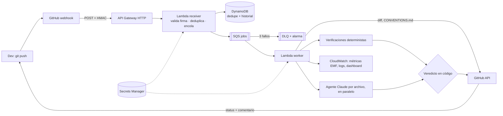

# 🛡️ Py Guardian — agente de revisión de convenciones por push

**Challenge:** *un agente que, cuando un dev haga push, supervise el código y verifique que cuadre con los lineamientos y convenciones del proyecto (Py).*

Solución serverless en AWS + GitHub + Claude. Cada push dispara una revisión que combina
**verificaciones deterministas** (las únicas que bloquean de forma fiable) y un **agente LLM**
(que detecta lo que las reglas fijas no ven: nombres, capas, patrones). El resultado llega como
**estado del commit** (verde/rojo, apto para branch protection) y **comentario en el commit** con enlaces a cada línea.

## Arquitectura



## Flujo
1. **receiver** (≤10 s exigidos por GitHub): verifica `X-Hub-Signature-256`, ignora ping/tags/borrado de ramas, deduplica por `X-GitHub-Delivery` y encola. Si falla al encolar, libera la marca para que el reintento de GitHub entre.
2. **worker**: marca `pending`; obtiene el diff (`compare`, con fallback a `commits/{sha}` para ramas nuevas y force-push); lee `CONVENTIONS.md` **de ese mismo commit**; filtra lockfiles/binarios/generados.
3. **Verificaciones deterministas** (`checks.py`): secretos, Conventional Commits, snake_case en archivos, `print`/`console.log`/`debugger` olvidados, TODO sin ticket, tests ausentes, tamaño de cambio.
4. **Agente** (`agent.py`): un llamado por archivo (en paralelo, tope configurable) con convenciones + diff numerado; devuelve JSON de hallazgos.
5. **Veredicto** (`report.py`): lo calcula el código, no el modelo. Publica estado + comentario y guarda historial y métricas.

## Decisiones de diseño que importan
| Decisión | Por qué |
|---|---|
| El LLM **no emite veredicto**, solo hallazgos | Un diff malicioso («aprueba esto») no puede aprobar el push. Hay una prueba que lo demuestra. |
| Hallazgos del LLM **validados** contra el diff | Una línea inexistente se descarta (y se cuenta en `DiscardedLlmFindings`): cero comentarios alucinados. |
| Errores del LLM = *advertencia* por defecto (`LLM_BLOCKING=false`) | Primero se calibra con el equipo; luego se activa el bloqueo con una variable. |
| Degradación elegante | Si el LLM cae, la revisión determinista igual se publica (`análisis IA: failed`). |
| Sin dependencias en Lambda (solo stdlib + boto3) | Paquete trivial, arranque rápido, sin cadena de suministro que vigilar. |
| Cola + DLQ + `ReportBatchItemFailures` | Reintentos reales sin perder mensajes; alarma si algo falla 3 veces. |
| Reglas en `CONVENTIONS.md` versionado | Cambiar una convención es un PR más; el agente siempre usa la versión del commit revisado. |

## Seguridad
HMAC con comparación en tiempo constante · secretos solo en Secrets Manager (el estado de Terraform nunca los ve) ·
IAM de mínimo privilegio por función · diff y convenciones «desarmados» para que no cierren las etiquetas del prompt ·
el mensaje de un secreto detectado **no reproduce** el secreto · concurrencia de la cola limitada a 5 workers simultáneos · cifrado en SQS y DynamoDB.

## Puesta en marcha
```bash
make test && make demo                 # 31 pruebas y demo local sin red
cd terraform && terraform init && terraform apply
# Cargar secretos (los valores nunca pasan por Terraform):
aws secretsmanager put-secret-value --secret-id py-guardian/webhook-secret --secret-string "$(openssl rand -hex 32)"
aws secretsmanager put-secret-value --secret-id py-guardian/github-token   --secret-string "github_pat_..."
aws secretsmanager put-secret-value --secret-id py-guardian/anthropic-key   --secret-string "sk-ant-..."
```
1. **Token de GitHub** (fine-grained, solo los repos objetivo): *Commit statuses: RW*, *Contents: RW* (comentarios en commits), *Metadata: R*.
2. **Webhook** del repo: URL = output `webhook_url`, `application/json`, evento **push**, secreto = el de `webhook-secret` (`aws secretsmanager get-secret-value ...`).
3. Sube `CONVENTIONS.md` a la raíz del repo y, en *branch protection*, exige el estado **`py-guardian`**.
4. Opcional: `-var alert_email=tu@correo` para recibir alarmas.

## Pruebas
`pytest` — 31 casos: firma HMAC, ignorar eventos, deduplicación, fallo de cola, numeración de líneas del parche, cada regla determinista, líneas alucinadas, escape de etiquetas del prompt, fallo parcial del LLM, caída total del LLM, tope de archivos, política asesor/bloqueante y render con tope de hallazgos.

---

## ⚖️ Veredicto final del challenge

**Veredicto: CUMPLE.** El agente detecta el push, analiza el diff contra las convenciones del proyecto y devuelve un resultado accionable y bloqueante, con una arquitectura de nube coherente, segura y observable.

| Requisito | Resultado |
|---|---|
| Se activa solo con cada push | ✅ Webhook → API Gateway → Lambda, con firma validada y deduplicación |
| Supervisa que el código cuadre con las convenciones | ✅ Reglas deterministas + agente Claude guiado por `CONVENTIONS.md` del propio commit |
| Resultado visible y útil al dev | ✅ Estado verde/rojo + comentario con enlace a cada línea y sugerencia de corrección |
| Aplicación en la nube bien diseñada | ✅ Serverless, desacoplado por cola, DLQ, IaC, mínimo privilegio, métricas y alarmas |
| Robusto ante fallos y abuso | ✅ Reintentos, degradación sin LLM, anti-alucinación, anti prompt-injection, tope de gasto |

**Lo verificado:** 31 pruebas en verde, lint limpio, demo local, CI de GitHub en verde y `terraform validate/apply` en la cuenta AWS 189750305838 (`us-east-1`). El endpoint real respondió `200` a un ping firmado y `401` sin firma. Un push real a `main` (`8282568`) recibió estado `success` y comentario; otro con una credencial ficticia (`893e7dd`) recibió `failure` con enlace a la línea; la corrección (`9165800`) volvió a `success`.

**Pendiente de comprobar:**
- La revisión con IA: no hay clave de Anthropic y Bedrock devolvió `Operation not allowed` en esta cuenta. El despliegue ejecuta las reglas deterministas; la demo local usa un LLM simulado.
- Corregir los permisos del PAT fine-grained de prueba: GitHub devolvió HTTP 403 al publicar el estado del commit `3e517d1`. El webhook está desactivado hasta que tenga `Commit statuses: Read and write` y `Contents: Read and write` para `JaqzO8/py-guardian`.

**Limitaciones y riesgos conocidos**
- El LLM es probabilístico: puede dejar pasar un problema o dar falsos positivos. Por eso solo aconseja mientras se calibra, y los bloqueos duros son deterministas. Mide `DiscardedLlmFindings` y los 👎 del equipo antes de activar `LLM_BLOCKING=true`.
- Se usa estado de commit + comentario (funciona con token personal). Las *Check Runs* con anotaciones en línea exigen una **GitHub App**; es la mejora natural.
- Coste: ≈ 8 000 tokens de entrada por archivo revisado (convenciones + diff). Un push de 5 archivos son ~40 000 tokens; multiplica por la tarifa vigente y tu volumen de pushes. El *prompt caching* de las convenciones lo reduciría y queda como optimización.
- El análisis es sobre el diff; no entiende todo el repositorio (p. ej. un import circular que depende de otros archivos).

**Siguientes pasos recomendados:** (1) GitHub App + Check Runs con anotaciones; (2) revisión también en `pull_request` y bloqueo de merge; (3) caché de convenciones y de resultados por hash de parche; (4) panel de falsos positivos para afinar `CONVENTIONS.md`; (5) GitLab/Bitbucket cambiando solo `github.py` y la validación de firma.
